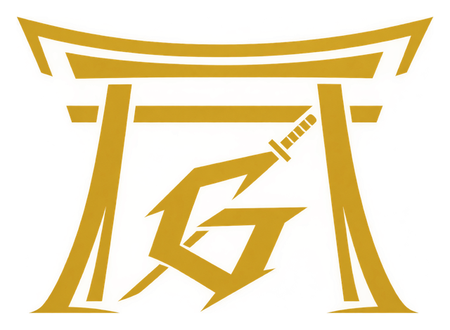

<p align="center"></p>

# ARCK — 3D architecture studio for the web

A free, no-install 3D architecture studio for students, designers and makers. It runs entirely in the browser (desktop and mobile), has a golden theme built around the ARCK torii "G" logo, and keeps every file on your own device.

## What's inside

| Page | What it does |
|---|---|
| `index.html` | Landing page with a live 3D hero |
| `studio.html` | Full editor: walls (typed lengths), rooms, slabs, move/rotate/scale gizmo, grid & angle snap, arrays, mirror, group, align, layers, section cut, sun & shadow study, measure, notes, lights, quantities & cost, undo/redo, auto-save, 7 templates |
| `shapes.html` · `structures.html` · `components.html` | ~150 parametric items (solids, polyhedra, arches, domes, vaults, trusses, bridges, towers, walls, doors, windows, classical columns, roofs, stairs, furniture, landscape…) with live sliders, materials, section view, scale figure, instructions and GLB/OBJ/STL download |
| `viewer.html` | Open your own GLB, glTF, OBJ(+MTL), STL, PLY, FBX, DAE, 3MF, 3DS or SVG; render modes, section, measure, unit fixes, parts list, export, "Open in Studio" |
| `tools.html` | 12 calculators: stairs, roof pitch, ramp, arch geometry, area & volume, concrete, bricks, paint, beam check, sun angle, units, cost |
| `learn.html` | Lessons, classical orders in 3D, glossary, quiz, challenges |
| `guide.html` | Instructions for every tool, shortcuts, formats, mobile gestures, FAQ |

The Studio has two layouts: a three-column desktop layout (tool rail · viewport · panel) and, below 900 px, a touch layout with a bottom navigation sheet, tool strip and floating selection bar.

## Studio features (v2)

- **Importing that keeps your model right**: drop a `.zip` (OBJ + MTL + textures), or select the OBJ, MTL and image files together. Colours, textures and transparency are kept. Unit (mm/cm/m/in/ft), up-axis (Y or Z) and real size are auto-detected and can be fixed live in the Edit tab (type the real width, pick unit/up, yaw, flip).
- **Zoom that always works**: wheel/pinch zooms toward the cursor at any model size; clipping and fog adapt to scene scale; the gizmo no longer blocks the view.
- **Realistic look**: sky lighting, soft shadows, ambient occlusion, edge outlines, textured brick/roof/plaster/stone, leaf-card trees. Clay, Drawing, Wire and X-ray display modes.
- **Studio tools**: area tool, camera bookmarks with fly-to and tour, walkthrough (WASD / touch), isolate, section cut, sun study, quantities, and an A3 drawing-sheet export with scale bar, north arrow and title block.
- Regenerate the home-page gallery with `python3 tests/render_showcase.py [url] [template ids]`.

## Run it

There is no build step. Serve the folder with any static server:

```bash
npm run serve        # or: python3 -m http.server 8731
# open http://localhost:8731
```

Opening `index.html` directly from disk will not work because browsers block ES modules on `file://`.

### Deploy

Push to GitHub and enable **Settings ▸ Pages ▸ Deploy from branch ▸ main / root**. Any static host (Netlify, Cloudflare Pages, S3) works too.

## Tech

- Plain ES modules with an import map; [three.js](https://threejs.org) r186 is vendored in `vendor/three/` (no CDN, works offline once loaded).
- `js/catalog/` – parametric builders (1 unit = 1 m); `js/engine/` – viewport, materials, importers/exporters; `js/studio/` – editor scene, tools and UI; `js/pages/` – page scripts.
- Service worker + web manifest make it installable and usable offline.
- Auto-save and hand-off use IndexedDB; learning progress uses localStorage.

## Tests

```bash
npm test                         # catalog (all items/params build), scene operations, templates
python3 tests/e2e_studio.py      # Studio end-to-end in headless Chromium (needs playwright + a running server)
```

## Notes

Quantities, costs and structural checks are learning estimates, not engineering advice. The previous Next.js/MongoDB prototype is archived in `legacy-src/` and `legacy-tests/` for reference only.

## License

MIT
